# Roteiro de Execução em Cascata: Debian-to-BerryCore (QNX Neutrino / BlackBerry Q5)

> **Modo de Operação:** Execução Sequencial Estrita em Cascata (*Waterfall + DAG*) com Portões de Verificação (*Quality Gates*).
> **Raiz do Repositório:** `/home/antigravity/Estagiarius/teste1` (estrutura diretamente na raiz de `teste1`).
> **Alvo:** BlackBerry Q5 — `armv7le` (`arm-blackberry-qnx8eabi`, ARM 32-bit `softfp`), QNX Neutrino 6.5/6.6, BlackBerry OS 10.
> **Prefixo Imutável no Dispositivo (`PREFIX`):** `/accounts/1000/shared/misc/berrycore`

---

## 0. Contrato de Execução e Protocolo do Agente

### 0.1 Convenção de Marcação de Tarefas
O agente deve atualizar este documento em tempo real conforme avança pela cascata:
- `[ ]` **Pendente** — ainda não iniciado.
- `[/]` **Em Execução** — etapa atualmente em andamento (apenas 1 item ativo por vez).
- `[x]` **Concluído** — implementado e validado pelo respectivo portão (*Gate*).
- `[!]` **Bloqueado (`BLOCKED`)** — falhou após 3 ciclos de correção (permitido apenas em pacotes não críticos das Camadas 2, 3 e 4, com log salvo em `logs/<pacote>-error.log` e registrado em `dist/manifest.json`).

### 0.2 Regras Invioláveis (Hard Constraints)
1. **Isolamento Total:** Toda compilação e instalação de ferramentas/bibliotecas ocorre exclusivamente dentro do contêiner Docker Linux `x86_64`. Nunca instalar dependências de build ou toolchains no sistema hospedeiro.
2. **Zero Host Leakage:** Nenhum binário ELF, biblioteca `.so`, arquivo `.pc` ou script final pode conter caminhos da máquina de build (`/usr/lib`, `/home/...`, `$STAGING`). Todos os caminhos embutidos devem apontar exclusivamente para `$PREFIX` (`/accounts/1000/shared/misc/berrycore`).
3. **Validação ELF Obrigatória:** Nenhum pacote pode ser marcado como `[x]` sem aprovação integral em `scripts/verify-elf.sh`.
4. **Ordem Estrita de Cascata:** É proibido avançar para a Fase `N+1` ou Camada `L+1` antes que o **Gate** da etapa atual esteja 100% aprovado.
5. **Isolamento de Falhas (Máximo 3 Tentativas):** Se um pacote falhar após 3 ciclos de diagnóstico/patch, registrar as últimas evidências em `logs/<pacote>-error.log`, marcá-lo como `[!]` (`BLOCKED`) neste roteiro e em `dist/manifest.json`, pular seus dependentes diretos e prosseguir com os pacotes independentes.
6. **Reprodutibilidade Determinística:** Todo patch aplicado em código-fonte deve ser versionado em `patches/<pacote>/*.patch` (nunca manter edições manuais efêmeras em `/tmp`).

### 0.3 Constantes Globais do Pipeline
| Variável | Valor Imutável |
| :--- | :--- |
| `REPO_ROOT` | `/home/antigravity/Estagiarius/teste1` |
| `TARGET` | `arm-blackberry-qnx8eabi` |
| `PREFIX` | `/accounts/1000/shared/misc/berrycore` |
| `STAGING` | `/workspace/staging` |
| `SYSROOT_PREFIX` | `/workspace/staging/accounts/1000/shared/misc/berrycore` |
| `TOOLCHAIN_DIR` | `/opt/bb10-gcc9` |
| `MAX_RETRIES` | `3` |

### 0.4 Diagrama de Cascata e DAG de Dependências

```mermaid
flowchart TD
    E0["Etapa 0: Inicialização da Estrutura do Repositório"] --> G_INIT{"Gate Init: Árvore Git pronta"}
    G_INIT --> F0["Fase 0: Infraestrutura Docker + Toolchain GCC 9.3 QNX"]
    F0 --> G0{"Gate 0: docker build=0 + hello.c ARM QNX ELF OK"}
    G0 --> F1["Fase 1: Motor de Build e Validação (scripts/)"]
    F1 --> G1{"Gate 1: env-cross, build-pkg, verify-elf e run-all validados"}
    G1 --> C0["Fase 2 / Camada 0: Bibliotecas de Fundação (00..08)"]
    C0 --> GC0{"Gate Camada 0: 100% SUCCESS obrigatório"}
    GC0 --> C1["Fase 2 / Camada 1: Criptografia e Rede Moderna (10..15)"]
    C1 --> GC1{"Gate Camada 1: 100% SUCCESS obrigatório"}
    GC1 --> C2["Fase 2 / Camada 2: Compressão e Núcleo POSIX/GNU (20..36)"]
    C2 --> GC2{"Gate Camada 2: ELF OK + falhas isoladas"}
    GC2 --> C3["Fase 2 / Camada 3: Shell, Multiplexador e Editores Q5 (40..47)"]
    C3 --> GC3{"Gate Camada 3: ELF OK + falhas isoladas"}
    GC3 --> C4["Fase 2 / Camada 4: Interpretadores e Clientes Avançados (50..55)"]
    C4 --> GC4{"Gate Camada 4: ELF OK + falhas isoladas"}
    GC4 --> F4["Fase 4: Strip, env.sh, Empacotamento .zip, SHA256, manifest.json e BUILD_REPORT.md"]
    F4 --> G4{"Gate 4: Artefatos e metadados íntegros"}
    G4 --> F5["Fase 5: Auditoria Global (Definition of Done)"]
    F5 --> DONE(["ENTREGA CONCLUÍDA"])
```



### 0.5 Painel de Rastreamento de Cascata

| Etapa | Descrição | Bloqueante? | Status |
| :--- | :--- | :---: | :---: |
| Etapa 0 | Estrutura do Repositório (raiz de `teste1`) | Sim | `[x]` |
| Fase 0 | Docker + Toolchain GCC 9.3 QNX | Sim (Gate 0) | `[!]` (Bloqueado em `F0.6` — rede/sysroot) |
| Fase 1 | Motor de Build e Validação (`scripts/`) | Sim (Gate 1) | `[/]` (Implementado; pendente `GATE-1.2` do Gate 0) |
| Fase 2 — Camada 0 | Bibliotecas de Fundação (9 pacotes) | Sim (100% obrigatório) | `[/]` (9/9 receitas criadas + DAG OK; pendente build Docker) |
| Fase 2 — Camada 1 | Pilha Criptográfica e Rede (6 pacotes) | Sim (100% obrigatórios) | `[/]` (6/6 receitas criadas + DAG OK; pendente build Docker) |
| Fase 2 — Camada 2 | Compressão e Núcleo POSIX/GNU (17 pacotes) | Parcial (isolamento) | `[/]` (17/17 receitas criadas + DAG OK; pendente build Docker) |
| Fase 2 — Camada 3 | Shell, Multiplexador e Teclado Q5 (8 pacotes) | Parcial (isolamento) | `[ ]` |
| Fase 2 — Camada 4 | Interpretadores e Clientes Avançados (6 pacotes) | Parcial (isolamento) | `[ ]` |
| Fase 4 | Empacotamento, Metadados e Relatório | Sim (Gate 4) | `[ ]` |
| Fase 5 | Auditoria Final (Definition of Done) | Sim (Gate Global) | `[ ]` |

---

## Etapa 0 — Inicialização da Arquitetura de Diretórios

**Pré-requisito:** Repositório Git inicializado na raiz de `teste1`.

### Checklist de Tarefas
- [x] **0.1** Criar a árvore completa de diretórios na raiz de `teste1`:
  - `docker/`
  - `scripts/`
  - `recipes/`
  - `patches/`
  - `downloads/`
  - `staging/`
  - `dist/packages/`
  - `logs/`
- [x] **0.2** Criar `.gitignore` preservando estrutura de diretórios via `.gitkeep` e ignorando binários temporários de build (`downloads/*`, `staging/*`, `dist/*.zip`, `dist/packages/*`, `logs/*.log`) enquanto mantém `patches/`, `recipes/`, `scripts/`, `docker/`, `ROTEIRO_CASCATA.md` e `BUILD_REPORT.md` versionados.
- [x] **0.3** Regra definida para permissões de execução (`chmod +x`) em todos os scripts a serem criados em `scripts/` (Fase 1).

### Gate Init (Critério de Passagem)
- [x] **GATE-INIT:** Todos os diretórios obrigatórios existem na raiz de `teste1`, `.gitignore` e `.gitkeep` configurados, `git status` limpo de temporários e Docker daemon verificado (`Docker 29.10.0` ativo).

---

## Fase 0 — Infraestrutura e Toolchain (Docker)

**Pré-requisito:** `GATE-INIT` aprovado.

### Checklist de Tarefas
- [x] **F0.1** Criar `docker/Dockerfile` baseado em `debian:bookworm-slim` (`--platform=linux/amd64`).
- [x] **F0.2** Configurar instalação de todas as dependências de host via `apt-get` (com limpeza de cache `/var/lib/apt/lists/*`):
  - `build-essential`, `cmake`, `autoconf`, `automake`, `libtool`, `pkg-config`, `bison`, `flex`, `gawk`, `m4`, `patch`, `git`, `git-lfs`, `curl`, `wget`, `ca-certificates`, `unzip`, `zip`, `xz-utils`, `python3`, `perl`, `file`, `binutils`, `texinfo`, `jq`.
- [x] **F0.3** Configurar download via Git LFS e extração da toolchain comunitária BerryCore GCC 9.3.0 (`toolchain/gcc-9.3.0-qnx8.tar.gz`) de `https://github.com/sw7ft/BerryCore` para `/opt/bb10-gcc9`, adicionando `/opt/bb10-gcc9/bin` ao `PATH` do contêiner.
- [x] **F0.4** Configurar atualização dos arquivos globais `/usr/share/misc/config.sub` e `/usr/share/misc/config.guess` a partir do repositório oficial GNU `config` para reconhecimento do alvo `arm-blackberry-qnx8eabi` / QNX.
- [x] **F0.5** Definir `WORKDIR /workspace` e variáveis `TOOLCHAIN_DIR`, `QNX_HOST` e `QNX_TARGET` no `docker/Dockerfile`.
- [!] **F0.6** Construir a imagem Docker do zero (`docker build --platform=linux/amd64 -t bb10-berrycore-builder:latest -f docker/Dockerfile .`) — **BLOQUEADO** pela política de rede da VM (`lookup registry-1.docker.io on 192.168.0.1:53: server misbehaving`; `media.githubusercontent.com` e `git.savannah.gnu.org` também bloqueados; log em `logs/phase0-docker-build.log`).

### Gate 0 — Critério de Aceitação (Bloqueante)
Executar dentro do contêiner recém-construído (aguardando liberação de rede/Turbo mode e verificação de sysroot BB10 NDK/QNX):
- [!] **GATE-0.1** `docker build` retornou código de saída `0` sem intervenção manual.
- [ ] **GATE-0.2** `arm-blackberry-qnx8eabi-gcc --version` executa e reporta GCC 9.3.x.
- [ ] **GATE-0.3** Compilar `hello.c` mínimo (usando `<stdio.h>` e `<sys/socket.h>`, linkando com `-lsocket`) via `arm-blackberry-qnx8eabi-gcc`.
- [ ] **GATE-0.4** Saída de `file hello` contém `ELF 32-bit LSB executable, ARM`.
- [ ] **GATE-0.5** Saída de `readelf -d hello` lista **apenas** bibliotecas nativas do QNX (`libc.so.3`, `libsocket.so.3`) e **nenhuma** referência a `libc.so.6` ou `ld-linux`.

---

## Fase 1 — Motor de Build e Validação Automatizada (`scripts/`)

**Pré-requisito:** `GATE-0` 100% aprovado.

### Checklist de Tarefas
- [x] **F1.1** Implementar `scripts/env-cross.sh` exportando obrigatoriamente:
  - `TARGET="arm-blackberry-qnx8eabi"`
  - `PREFIX="/accounts/1000/shared/misc/berrycore"`
  - `STAGING="/workspace/staging"`
  - `SYSROOT_PREFIX="${STAGING}${PREFIX}"`
  - `CC`, `CXX`, `AR`, `AS`, `LD`, `RANLIB`, `STRIP`, `NM`, `READELF` apontando para `${TOOLCHAIN_DIR}/bin/arm-blackberry-qnx8eabi-*`
  - `HOSTCC="gcc"` e `HOSTCXX="g++"` (para ferramentas auxiliares no host)
  - `PKG_CONFIG_LIBDIR="${SYSROOT_PREFIX}/lib/pkgconfig:${SYSROOT_PREFIX}/share/pkgconfig"`
  - `PKG_CONFIG_SYSROOT_DIR="${STAGING}"` e `unset PKG_CONFIG_PATH`
  - `CFLAGS="-O2 -pipe -I${SYSROOT_PREFIX}/include"`
  - `CXXFLAGS="-O2 -pipe -I${SYSROOT_PREFIX}/include"`
  - `CPPFLAGS="-I${SYSROOT_PREFIX}/include"`
  - `LDFLAGS="-L${SYSROOT_PREFIX}/lib -Wl,-rpath,${PREFIX}/lib -lsocket"`
- [x] **F1.2** Implementar `scripts/verify-elf.sh` recebendo um arquivo ou diretório e executando as 4 validações em todos os arquivos ELF encontrados:
  1. **Arquitetura:** confirmar `ELF 32-bit LSB` e `ARM` via `file` / `readelf -h` (falhar imediatamente se `x86-64` ou outra arquitetura).
  2. **Contaminação Linux:** confirmar que `readelf -d` não contém `libc.so.6`, `ld-linux`, `libpthread.so.0` ou `libdl.so.2`.
  3. **Resolução de Dependências (`NEEDED`):** confirmar que toda biblioteca listada em `NEEDED` existe no sysroot da toolchain QNX (`/opt/bb10-gcc9/...`) ou em `${SYSROOT_PREFIX}/lib`.
  4. **Proibição de Host Leakage:** confirmar que `RPATH`/`RUNPATH` não contêm `$STAGING`, `/usr/lib` ou `/home/`.
- [x] **F1.3** Implementar `scripts/build-pkg.sh` recebendo `recipes/<id>-<pkg>.sh` e executando o ciclo completo:
  1. Carregar `scripts/env-cross.sh` e a receita alvo (`PKG_NAME`, `PKG_VER`, `PKG_URL`, `PKG_SHA256`, `PKG_DEPS`, `build()`, `install_staging()`).
  2. Baixar tarball para `downloads/` (reutilizando cache local se existir) e validar integridade via `sha256sum`.
  3. Limpar e extrair em `/tmp/build/${PKG_NAME}`.
  4. Substituir preventivamente qualquer `config.sub` e `config.guess` encontrado na árvore extraída pelos arquivos atualizados de `/usr/share/misc/`.
  5. Aplicar em ordem alfabética todos os patches em `patches/${PKG_NAME}/*.patch`.
  6. Registrar snapshot dos arquivos em `${SYSROOT_PREFIX}` antes da instalação (para rastrear artefatos do pacote individual e gerar o `.zip` modular).
  7. Executar `build()` e `install_staging()` redirecionando stdout/stderr para `logs/${PKG_NAME}.log`.
  8. Auditar novos arquivos contra *host leakage* (scripts, arquivos `.pc` e `.la` sem caminhos `$STAGING` residuais).
  9. Executar obrigatoriamente `scripts/verify-elf.sh` sobre todos os novos binários e `.so` instalados pelo pacote.
  10. Gravar metadados parciais do pacote (lista de arquivos, binários, `NEEDED`, tamanho em KB, status `SUCCESS`).
- [x] **F1.4** Implementar `scripts/run-all.sh`:
  - Iterar receitas em `recipes/[0-9][0-9]-*.sh` em ordem numérica estrita (DAG).
  - Verificar se todas as dependências em `PKG_DEPS` possuem status `SUCCESS`; se alguma dependência estiver `BLOCKED`, marcar o pacote dependente como `BLOCKED` (motivo: dependência bloqueada) sem interromper pacotes independentes.
  - Consolidar o estado em `dist/manifest.json`.
  - Falhar com exit code != 0 se qualquer pacote obrigatório da Camada 0 ou Camada 1 não atingir `SUCCESS`.
- [x] **F1.5** Implementar `scripts/package.sh` completo (strip, pós-strip `verify-elf.sh`, `env.sh`, zips modulares e consolidado, `SHA256SUMS`, `manifest.json` e `BUILD_REPORT.md`, pronto para execução na Fase 4).

### Gate 1 — Critério de Aceitação (Bloqueante)
- [x] **GATE-1.1** `bash -n scripts/*.sh` retorna `0` (zero erros de sintaxe).
- [ ] **GATE-1.2** Teste positivo de `scripts/verify-elf.sh`: retorna `0` sobre o binário `hello` (ARM QNX) compilado no Gate 0 *(aguarda compilação do `hello` no contêiner do Gate 0)*.
- [x] **GATE-1.3** Teste negativo de `scripts/verify-elf.sh`: retorna código diferente de `0` ao analisar `/bin/ls` (`x86_64`/glibc), reportando `[ARCH]` e `[LINUX-LEAK]`.
- [x] **GATE-1.4** `scripts/env-cross.sh` isola `pkg-config` (`PKG_CONFIG_PATH` limpo, `pkg-config --list-all` = 0 itens do host) e `scripts/build-pkg.sh` rejeita execução fora do contêiner Docker.

---

## Fase 2 — Execução do DAG de Compilação (Camadas 0 a 4)

> **Regra de Execução por Pacote:** Para cada item abaixo, o agente deve:
> 1. Criar a receita `recipes/<id>-<pkg>.sh` (com URL upstream oficial, SHA256 verificado, `PKG_DEPS`, `build()` e `install_staging()`).
> 2. Executar `scripts/build-pkg.sh recipes/<id>-<pkg>.sh` dentro do contêiner Docker.
> 3. Em caso de falha, acionar imediatamente o **Protocolo Determinístico de Autocorreção (Fase 3)** — máximo 3 tentativas.
> 4. Marcar `[x]` somente após `scripts/verify-elf.sh` retornar `0`.

---

### Camada 0 — Bibliotecas de Fundação (OBRIGATÓRIA: 100% SUCCESS)

**Pré-requisito:** `GATE-1` aprovado.

- [/] **C0.0** `recipes/00-zlib.sh` — `zlib` `1.4` *(receita criada + SHA256 fixado + sintaxe/DAG OK; pendente build Docker)*
  - *Dependências:* nenhuma.
  - *Notas técnicas:* gerar `libz.so` e `libz.a` em `${SYSROOT_PREFIX}/lib` e cabeçalhos em `${SYSROOT_PREFIX}/include`; usar `CHOST=${TARGET}`.
- [/] **C0.1** `recipes/01-ncurses.sh` — `ncurses` `6.5` + `ncurses-bin` *(receita criada + sintaxe/DAG OK; pendente build Docker)*
  - *Dependências:* nenhuma.
  - *Notas técnicas:* compilar `tic` nativo no host primeiro (se necessário para gerar base `terminfo` sem `Exec format error`); habilitar wide-char (`--enable-widec`), `--with-shared`, `--with-termlib` (ou links de compatibilidade `libncurses.so` -> `libncursesw.so`), gerar `tput`, `clear`, `infocmp` e base `terminfo` em `${PREFIX}/share/terminfo`.
- [/] **C0.2** `recipes/02-readline.sh` — `readline` `8.2.13` *(receita criada + sintaxe/DAG OK; pendente build Docker)*
  - *Dependências:* `ncurses`.
  - *Notas técnicas:* passar `--with-curses` e `SHLIB_LIBS="-lncursesw"` (ou `-ltinfow`), pré-definir cache cross `bash_cv_wcwidth_broken=no`.
- [/] **C0.3** `recipes/03-libevent.sh` — `libevent` `2.1.13-stable` *(receita criada + SHA256 fixado + sintaxe/DAG OK; pendente build Docker)*
  - *Dependências:* nenhuma (base para `tmux`; compilar sem OpenSSL nesta camada ou habilitar suporte básico de eventos via `select`/`poll`).
  - *Notas técnicas:* desabilitar `epoll` Linux (`--disable-epoll` se disponível ou via `#ifdef __QNXNTO__`).
- [/] **C0.4** `recipes/04-pcre2.sh` — `pcre2` `10.49` *(receita criada + SHA256 fixado + sintaxe/DAG OK; pendente build Docker)*
  - *Dependências:* `zlib`.
  - *Notas técnicas:* habilitar `--enable-pcre2-8`, `--enable-unicode`, desabilitar JIT caso incompatível com QNX ARMv7 softfp.
- [/] **C0.5** `recipes/05-libffi.sh` — `libffi` `3.8.1` *(receita criada + SHA256 fixado + sintaxe/DAG OK; pendente build Docker)*
  - *Dependências:* nenhuma.
  - *Notas técnicas:* validar suporte ARM EABI (`softfp`); base obrigatória para `python3`.
- [/] **C0.6** `recipes/06-expat.sh` — `expat` `2.10.0` *(receita criada + SHA256 fixado + sintaxe/DAG OK; pendente build Docker)*
  - *Dependências:* nenhuma.
  - *Notas técnicas:* base obrigatória para módulo XML do `python3`.
- [/] **C0.7** `recipes/07-sqlite3.sh` — `sqlite3` `3.47.2` *(receita criada + sintaxe/DAG OK; pendente build Docker)*
  - *Dependências:* `zlib`, `ncurses`, `readline`.
  - *Notas técnicas:* usar tarball *autoconf amalgamation* em C puro; gerar `libsqlite3.so` e CLI `sqlite3`.
- [/] **C0.8** `recipes/08-ca-certificates.sh` — `ca-certificates` `2025-10` *(receita criada + sintaxe/DAG OK; pendente build Docker)*
  - *Dependências:* nenhuma.
  - *Notas técnicas:* empacotar bundle atualizado de certificados raiz (Mozilla/curl `cacert.pem` ou Debian `ca-certificates`) em `${SYSROOT_PREFIX}/etc/ssl/certs/ca-certificates.crt`.

#### Gate Camada 0 (Bloqueante — 100% Obrigatório)
- [ ] **GATE-C0.1** Todos os 9 pacotes (`00` a `08`) possuem status `SUCCESS` (zero `BLOCKED`).
- [ ] **GATE-C0.2** `scripts/verify-elf.sh ${SYSROOT_PREFIX}` retorna `0` erros.
- [ ] **GATE-C0.3** `${SYSROOT_PREFIX}/etc/ssl/certs/ca-certificates.crt` existe e não está vazio.

---

### Camada 1 — Pilha Criptográfica e Rede Moderna (PRIORIDADE CRÍTICA — 100% SUCCESS)

**Pré-requisito:** `GATE-C0` 100% aprovado.

- [/] **C1.0** `recipes/10-openssl.sh` — `openssl` `3.5.9` (3.x LTS) *(receita criada + SHA256 fixado + sintaxe/DAG OK; pendente build Docker)*
  - *Dependências:* `zlib`, `ca-certificates`.
  - *Notas técnicas:* configurar com `--prefix=${PREFIX}`, `--openssldir=${PREFIX}/etc/ssl`, alvo QNX ou `linux-generic32` adaptado (sem `linux/random.h`/dependências Linux, sem `async`/dso incompatível se falhar, linkando `-lsocket`, `no-tests`, `shared`, `zlib`). Instalar via `make DESTDIR=${STAGING} install_sw install_ssldirs`.
- [/] **C1.1** `recipes/11-nghttp2.sh` — `nghttp2` `1.71.0` *(receita criada + SHA256 fixado + sintaxe/DAG OK; pendente build Docker)*
  - *Dependências:* `zlib`, `openssl`.
  - *Notas técnicas:* compilar apenas biblioteca (`--enable-lib-only`) para fornecer HTTP/2 ao `curl`.
- [/] **C1.2** `recipes/12-curl.sh` — `curl` `8.23.0` *(receita criada + SHA256 fixado + sintaxe/DAG OK; pendente build Docker)*
  - *Dependências:* `openssl`, `zlib`, `ca-certificates`, `nghttp2` (opcional se disponível).
  - *Notas técnicas:* passar `--with-openssl=${SYSROOT_PREFIX}`, `--with-zlib=${SYSROOT_PREFIX}`, `--with-ca-bundle=${PREFIX}/etc/ssl/certs/ca-certificates.crt`, `--without-libpsl` (se não compilado).
- [/] **C1.3** `recipes/13-wget.sh` — `wget` `1.25.0` *(receita criada + sintaxe/DAG OK; pendente build Docker)*
  - *Dependências:* `openssl`, `zlib`, `pcre2`, `ca-certificates`.
  - *Notas técnicas:* `--with-ssl=openssl`, `--with-openssl=yes`, `--disable-iri`.
- [/] **C1.4** `recipes/14-openssh-client.sh` — `openssh-client` `10.6p2` *(receita criada + sintaxe/DAG OK; pendente build Docker)*
  - *Dependências:* `openssl`, `zlib`.
  - *Notas técnicas:* gerar e instalar `ssh`, `scp`, `sftp`, `ssh-keygen`, `ssh-agent` (`--with-ssl-dir=${SYSROOT_PREFIX}`, `--with-zlib=${SYSROOT_PREFIX}`, `--disable-strip` para evitar strip com binário host).
- [/] **C1.5** `recipes/15-rsync.sh` — `rsync` `3.5.2` *(receita criada + SHA256 fixado + sintaxe/DAG OK; pendente build Docker)*
  - *Dependências:* `zlib`, `openssl`.
  - *Notas técnicas:* `--disable-xxhash --disable-zstd --disable-lz4` (a menos que adicionados explicitamente à Camada 0), `--enable-openssl`.

#### Gate Camada 1 (Bloqueante — 100% Obrigatório nos Pacotes Críticos)
- [ ] **GATE-C1.1** `openssl`, `curl`, `wget`, `openssh-client` e `rsync` possuem status `SUCCESS` (100% obrigatório conforme Definition of Done).
- [ ] **GATE-C1.2** `scripts/verify-elf.sh ${SYSROOT_PREFIX}` retorna `0` erros em todos os binários e bibliotecas `.so` (`libssl.so.3`, `libcrypto.so.3`, `libcurl.so`, `curl`, `wget`, `ssh`, `scp`, `sftp`, `ssh-keygen`, `ssh-agent`, `rsync`).
- [ ] **GATE-C1.3** Verificação de strings confirma que `curl` e `openssl` referenciam `${PREFIX}/etc/ssl` e nenhum caminho de `$STAGING`.

---

### Camada 2 — Compressão e Núcleo POSIX/GNU

**Pré-requisito:** `GATE-C1` 100% aprovado.

- [/] **C2.0** `recipes/20-bzip2.sh` — `bzip2` `1.0.8` *(receita criada + sintaxe/DAG OK; pendente build Docker)*
- [/] **C2.1** `recipes/21-xz.sh` — `xz-utils` `5.8.4` *(receita criada + SHA256 fixado + sintaxe/DAG OK; pendente build Docker)*
- [/] **C2.2** `recipes/22-gzip.sh` — `gzip` `1.13` *(receita criada + sintaxe/DAG OK; pendente build Docker)*
- [/] **C2.3** `recipes/23-tar.sh` — `tar` `1.35` *(GNU tar com `gzip`, `bzip2`, `xz`; receita criada + sintaxe/DAG OK)*
- [/] **C2.4** `recipes/24-zip.sh` — `zip` `3.0` *(alvo `generic`/POSIX; receita criada + sintaxe/DAG OK)*
- [/] **C2.5** `recipes/25-unzip.sh` — `unzip` `6.0` *(alvo `generic`/POSIX; receita criada + sintaxe/DAG OK)*
- [/] **C2.6** `recipes/26-diffutils.sh` — `diffutils` `3.10` (`diff`, `cmp`, `diff3`, `sdiff`) *(receita criada + sintaxe/DAG OK)*
- [/] **C2.7** `recipes/27-patch.sh` — `patch` `2.7.6` *(receita criada + sintaxe/DAG OK)*
- [/] **C2.8** `recipes/28-sed.sh` — `sed` `4.9` *(receita criada + sintaxe/DAG OK)*
- [/] **C2.9** `recipes/29-mawk.sh` — `mawk` `1.3.4-20250131` *(AWK leve com `BUILD_CC=gcc` e `-lm`; receita criada + sintaxe/DAG OK)*
- [/] **C2.10** `recipes/30-grep.sh` — `grep` `3.11` *(vinculado a `pcre2`; receita criada + sintaxe/DAG OK)*
- [/] **C2.11** `recipes/31-findutils.sh` — `findutils` `4.10.0` (`find`, `xargs`) *(receita criada + sintaxe/DAG OK)*
- [/] **C2.12** `recipes/32-coreutils.sh` — `coreutils` `9.5` *(`fu_cv_sys_stat_statfs2_bsize=yes`, sem SELinux/Linux; receita criada + sintaxe/DAG OK)*
- [/] **C2.13** `recipes/33-less.sh` — `less` `668` *(vinculado a `ncurses` + `pcre2`; receita criada + sintaxe/DAG OK)*
- [/] **C2.14** `recipes/34-file.sh` — `file` `5.46` *(compila `file` host primeiro para gerar `magic.mgc`; receita criada + sintaxe/DAG OK)*
- [/] **C2.15** `recipes/35-tree.sh` — `tree` `2.3.2` *(receita criada + sintaxe/DAG OK)*
- [/] **C2.16** `recipes/36-xxd.sh` — `xxd` `9.2.1393` *(compilação standalone de `xxd.c`; receita criada + sintaxe/DAG OK)*

#### Gate Camada 2
- [ ] **GATE-C2.1** Todos os pacotes concluídos passaram em `scripts/verify-elf.sh` com `0` erros.
- [ ] **GATE-C2.2** Qualquer pacote que falhou após 3 ciclos está documentado em `logs/<pacote>-error.log` e marcado como `BLOCKED` no `dist/manifest.json`.
- [ ] **GATE-C2.3** Todos os patches criados nesta camada estão salvos em `patches/<pacote>/`.

---

### Camada 3 — Shell, Multiplexador e Produtividade no Teclado Q5

**Pré-requisito:** `GATE-C2` concluído.

- [ ] **C3.0** `recipes/40-dash.sh` — `dash` (shell POSIX ultrarrápido; usar `CC_FOR_BUILD=gcc` para utilitários geradores de código `mkinit`/`mknodes`/`mksyntax`)
- [ ] **C3.1** `recipes/41-bash.sh` — `bash` + `bash-completion` (vinculado a `readline` e `ncurses`: `--with-installed-readline=${SYSROOT_PREFIX}`, `--without-bash-malloc`, variáveis `bash_cv_*` para cross-compile; instalar scripts de `bash-completion` em `${PREFIX}/share/bash-completion`)
- [ ] **C3.2** `recipes/42-tmux.sh` — `tmux` (vinculado a `libevent` e `ncurses`; checar `forkpty`/`openpty` e `utempter` no QNX)
- [ ] **C3.3** `recipes/43-nano.sh` — `nano` (vinculado a `ncurses`: `--enable-utf8`)
- [ ] **C3.4** `recipes/44-vim.sh` — `vim-tiny` / `vim` sem GUI (vinculado a `ncurses`: `--with-features=tiny` ou `normal`, `--disable-gui`, `--without-x`, variáveis `vim_cv_*` para cross-compile)
- [ ] **C3.5** `recipes/45-bc.sh` — `bc` (atenção ao gerador `fbc` em cross-compile — compilar auxiliar no host se necessário)
- [ ] **C3.6** `recipes/46-time.sh` — `time` (GNU time)
- [ ] **C3.7** `recipes/47-gettext-base.sh` — `gettext-base` (`envsubst` em `gettext-runtime`)

#### Gate Camada 3
- [ ] **GATE-C3.1** Todos os binários e bibliotecas gerados passaram em `scripts/verify-elf.sh` com `0` erros.
- [ ] **GATE-C3.2** Scripts de `bash-completion` e shebangs instalados não contêm caminhos host (`$STAGING` ou `/home/...`).
- [ ] **GATE-C3.3** Patches salvos em `patches/<pacote>/` e eventuais bloqueios registrados em `logs/<pacote>-error.log`.

---

### Camada 4 — Interpretadores e Clientes de Terminal Avançados

**Pré-requisito:** `GATE-C3` concluído.

- [ ] **C4.0** `recipes/50-python3.sh` — `python3`
  - *Dependências:* `openssl`, `zlib`, `libffi`, `sqlite3`, `ncurses`, `readline`, `bzip2`, `xz`, `expat`.
  - *Notas técnicas:*
    1. Compilar Python da **exata mesma versão** para o host Linux em `/tmp/build/python3-host`.
    2. Passar `--with-build-python=/tmp/build/python3-host/python`, `--build=x86_64-pc-linux-gnu`, `--host=${TARGET}`, `--with-openssl=${SYSROOT_PREFIX}`, `--enable-shared`.
    3. Pré-definir variáveis cross obrigatórias (`ac_cv_file__dev_ptmx`, `ac_cv_file__dev_ptc`, `ac_cv_buggy_getaddrinfo=no`).
    4. Validar que módulos críticos em `lib-dynload/*.so` (`_ssl`, `zlib`, `_ctypes`, `_sqlite3`, `_bz2`, `_lzma`, `readline`, `_curses`) foram compilados e passam no `verify-elf.sh`.
- [ ] **C4.1** `recipes/51-bdwgc.sh` — `bdwgc` (Boehm GC — pré-requisito para `w3m`)
- [ ] **C4.2** `recipes/52-w3m.sh` — `w3m` (vinculado a `bdwgc`, `ncurses`, `openssl`; atenção a `mktable` que precisa ser compilado com `HOSTCC=gcc`)
- [ ] **C4.3** `recipes/53-mutt.sh` — `mutt` (cliente IMAP/SMTP vinculado a `ncurses` e `openssl`: `--enable-imap --enable-smtp --with-ssl=${SYSROOT_PREFIX}`)
- [ ] **C4.4** `recipes/54-netcat-openbsd.sh` — `netcat-openbsd` (adaptar chamadas BSD/socket específicas com `#ifdef __QNXNTO__` e `-lsocket`)
- [ ] **C4.5** `recipes/55-whois.sh` — `whois` (compilar com `CC=${CC}` e `-lsocket`; desabilitar `libidn2` se ausente)

#### Gate Camada 4
- [ ] **GATE-C4.1** `scripts/verify-elf.sh ${SYSROOT_PREFIX}` retorna `0` erros em todos os binários e módulos dinâmicos (incluindo `libpython3*.so` e `lib-dynload/*.so`).
- [ ] **GATE-C4.2** Eventuais pacotes bloqueados registrados após 3 tentativas com log e status `BLOCKED`.
- [ ] **GATE-C4.3** Todos os patches versionados em `patches/`.

---

## Fase 3 — Protocolo Determinístico de Autocorreção (Transversal às Fases 2.0–2.4)

Sempre que `scripts/build-pkg.sh` falhar em qualquer pacote da Fase 2, o agente **DEVE** executar este loop determinístico (máximo `3` ciclos por pacote):

### Loop de Remediação
1. **Inspeção:** Ler as últimas 80 linhas de `logs/<pacote>.log` (e `config.log` se a falha ocorrer no `./configure`).
2. **Classificação e Correção:** Aplicar a ação correspondente da tabela abaixo.
3. **Versionamento:** Se alterou código-fonte, gerar `diff -u` limpo e salvar em `patches/<pacote>/<nn>-<descricao>.patch`. Se alterou flags/cache, atualizar `recipes/<id>-<pacote>.sh`.
4. **Reexecução Limpa:** Rodar novamente `scripts/build-pkg.sh recipes/<id>-<pacote>.sh` a partir de `/tmp/build/<pacote>` limpo.
5. **Isolamento (se Tentativa 3 falhar):**
   - Salvar diagnóstico + últimas 120 linhas do log em `logs/<pacote>-error.log`.
   - Registrar `status: "BLOCKED"` + resumo da causa raiz em `dist/manifest.json`.
   - Marcar `[!]` no item correspondente deste roteiro.
   - Se o pacote for da Camada 0 ou Camada 1 obrigatória, **PARAR** e escalar/resolver antes de prosseguir (pois o Definition of Done exige 100% de sucesso nessas camadas).

### Matriz Determinística de Remediação

| Padrão de Erro Detectado no Log | Ação Corretiva Obrigatória |
| :--- | :--- |
| `undefined reference to 'socket'`, `'connect'`, `'getaddrinfo'`, `'recv'`, `'send'` | Incluir `-lsocket` em `LIBS` ou `LDFLAGS` na receita do pacote. |
| `undefined reference to 'sin'`, `'floor'`, `'pow'`, `'sqrt'`, `'log'` | Incluir `-lm` em `LIBS` ou `LDFLAGS` na receita do pacote. |
| `cannot guess build type` / `Invalid configuration 'arm-blackberry-qnx8eabi'` | Substituir todos os `config.sub` e `config.guess` do tarball pelos arquivos atualizados em `/usr/share/misc/`. |
| `error: sys/sysmacros.h: No such file` ou `epoll.h` ausente | Verificar flags `./configure --disable-epoll` / `--with-select`; se não existir flag, criar patch em `patches/<pacote>/` protegido por `#ifdef __QNXNTO__`. |
| `cannot run test program while cross compiling` | Inspecionar `config.log`, identificar a variável `ac_cv_*` / `gl_cv_*` / `bash_cv_*` / `vim_cv_*` correspondente e pré-defini-la na invocação do `./configure`. |
| `Exec format error` durante `make` | O `Makefile` tentou executar um binário ARM compilado como ferramenta auxiliar no host `x86_64`. Compilar a ferramenta auxiliar com `gcc` do host primeiro e injetá-la via variável (ex.: `HOSTCC=gcc`, `CC_FOR_BUILD=gcc`, `--with-build-python=...`). |
| `fatal error: openssl/ssl.h` ou biblioteca `.so`/`.h` não encontrada | Confirmar que a dependência está em camada anterior do DAG com status `SUCCESS` e que `CFLAGS`, `LDFLAGS`, `PKG_CONFIG_LIBDIR` e `PKG_CONFIG_SYSROOT_DIR` apontam corretamente para `${SYSROOT_PREFIX}` / `${STAGING}`. |

---

## Fase 4 — Empacotamento, Metadados e Entrega (`scripts/package.sh`)

**Pré-requisito:** Camadas 0 a 4 concluídas (Gates `C0` a `C4` encerrados).

### Checklist de Tarefas
- [ ] **F4.1** Finalizar `scripts/package.sh` executando sequencialmente:
  1. **Otimização (Strip):** Executar `arm-blackberry-qnx8eabi-strip --strip-unneeded` em todos os executáveis ELF e bibliotecas `.so` dentro de `${SYSROOT_PREFIX}`, preservando intactos scripts shell, Python, Perl, arquivos de texto e certificados.
  2. **Revalidação Pós-Strip:** Rodar `scripts/verify-elf.sh ${SYSROOT_PREFIX}` após o strip para garantir que nenhum ELF foi corrompido.
  3. **Geração de `${SYSROOT_PREFIX}/env.sh`** com exatamente o seguinte contrato:
     ```sh
     export PREFIX="/accounts/1000/shared/misc/berrycore"
     export PATH="$PREFIX/bin:$PREFIX/sbin:$PATH"
     export LD_LIBRARY_PATH="$PREFIX/lib:$LD_LIBRARY_PATH"
     export TERMINFO="$PREFIX/share/terminfo"
     export SSL_CERT_FILE="$PREFIX/etc/ssl/certs/ca-certificates.crt"
     export CURL_CA_BUNDLE="$PREFIX/etc/ssl/certs/ca-certificates.crt"
     export MANPATH="$PREFIX/share/man:$MANPATH"
     ```
  4. **Empacotamento Modular:** Gerar `dist/packages/<pacote>-<versao>-bb10-armv7le.zip` para cada pacote com status `SUCCESS`, mantendo caminhos relativos à raiz `$PREFIX` (ex.: `bin/...`, `lib/...`, `share/...`, `etc/...`).
  5. **Empacotamento Consolidado:** Gerar `dist/berrycore-debian-suite-armv7le.zip` contendo integralmente o conteúdo de `${SYSROOT_PREFIX}` (caminhos relativos a `$PREFIX`).
  6. **Checksums:** Gerar `dist/SHA256SUMS` cobrindo `berrycore-debian-suite-armv7le.zip` e todos os arquivos em `packages/*.zip`.
  7. **Manifesto JSON:** Gerar/atualizar `dist/manifest.json` com o esquema:
     ```json
     {
       "target": "arm-blackberry-qnx8eabi",
       "prefix": "/accounts/1000/shared/misc/berrycore",
       "generated_at": "ISO-8601",
       "summary": { "total": 0, "success": 0, "blocked": 0 },
       "packages": [
         {
           "id": "00",
           "name": "zlib",
           "version": "1.3.1",
           "layer": 0,
           "status": "SUCCESS",
           "size_kb": 123,
           "binaries": [],
           "libraries": [],
           "needed": [],
           "patches": [],
           "error_summary": null
         }
       ]
     }
     ```
- [ ] **F4.2** Executar `scripts/package.sh` dentro do contêiner Docker.
- [ ] **F4.3** Gerar `BUILD_REPORT.md` na raiz do repositório contendo:
  - Resumo executivo e taxa de sucesso (global e por camada).
  - Tabela completa de pacotes compilados (nome, versão, camada, status, tamanho em KB).
  - Inventário de patches criados em `patches/` com justificativa técnica QNX.
  - Lista de pacotes `BLOCKED` (se houver) com resumo da causa raiz e ponteiro para `logs/<pacote>-error.log`.
  - **Guia de Instalação no BlackBerry Q5 (Term49):** comandos exatos para extrair `berrycore-debian-suite-armv7le.zip` em `/accounts/1000/shared/misc/berrycore`, carregar `source /accounts/1000/shared/misc/berrycore/env.sh` e executar testes de sanidade (`curl --version`, `openssl version`, `ssh -V`).

### Gate 4 — Critério de Aceitação (Bloqueante)
- [ ] **GATE-4.1** `dist/berrycore-debian-suite-armv7le.zip` existe e `unzip -t dist/berrycore-debian-suite-armv7le.zip` retorna `0`.
- [ ] **GATE-4.2** `(cd dist && sha256sum -c SHA256SUMS)` retorna `0` para 100% dos arquivos listados.
- [ ] **GATE-4.3** `jq empty dist/manifest.json` valida JSON bem-formado e consistente com todos os pacotes do DAG.
- [ ] **GATE-4.4** `BUILD_REPORT.md` gerado, completo e sem placeholders pendentes.

---

## Fase 5 — Auditoria Final (Definition of Done)

**Pré-requisito:** `GATE-4` aprovado.

Executar esta verificação final antes de encerrar a execução autônoma:

- [ ] **DOD.1** Imagem Docker constrói do zero sem intervenção manual (`docker build` = código `0`).
- [ ] **DOD.2** `scripts/run-all.sh` concluiu todas as camadas do DAG e registrou cada resultado em `dist/manifest.json`.
- [ ] **DOD.3** 100% dos pacotes obrigatórios da Camada 0 e Camada 1 (`zlib`, `ncurses`, `ca-certificates`, `openssl`, `curl`, `wget`, `openssh-client`, `rsync` — além das demais fundações da Camada 0) possuem status `SUCCESS`.
- [ ] **DOD.4** `scripts/verify-elf.sh` reporta **0 erros** em todos os artefatos incluídos no `dist/berrycore-debian-suite-armv7le.zip` (nenhum binário `x86_64`, nenhuma dependência `glibc`, nenhuma biblioteca `.so` órfã).
- [ ] **DOD.5** Auditoria de *host leakage* (`grep -rnE '/workspace/staging|/home/|/usr/lib' ${SYSROOT_PREFIX}/env.sh ${SYSROOT_PREFIX}/lib/pkgconfig 2>/dev/null`) retorna vazio.
- [ ] **DOD.6** Todos os patches aplicados estão versionados em `patches/` (nenhuma alteração manual perdida em `/tmp`).
- [ ] **DOD.7** `dist/berrycore-debian-suite-armv7le.zip`, `dist/SHA256SUMS`, `dist/manifest.json` e `BUILD_REPORT.md` estão presentes e íntegros.
- [ ] **DOD.8** Todos os checkboxes deste roteiro estão atualizados com o estado final (`[x]` ou `[!]`) e o Painel de Rastreamento (Seção 0.5) está preenchido.
